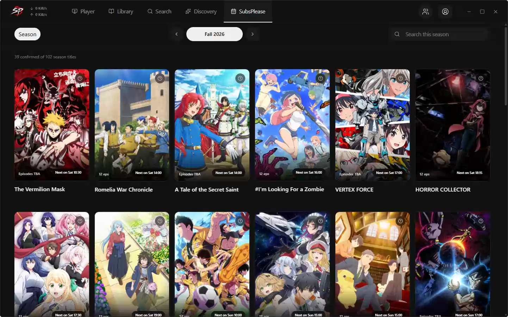

<p align="center">
  
</p>

<h1 align="center">StreamsPlease</h1>

<p align="center">
  <b>Pick a show, press play, watch it with friends.</b><br>
  A Windows desktop player that streams anime releases from the SubsPlease catalog over BitTorrent.
</p>

<p align="center">
  
  
  
  
  <a href="LICENSE"></a>
</p>

<p align="center">
  <a href="#features">Features</a> ·
  <a href="#watch-together">Watch together</a> ·
  <a href="#install">Install</a> ·
  <a href="#build-from-source">Build from source</a> ·
  <a href="#documentation">Documentation</a> ·
  <a href="#disclaimer">Disclaimer</a>
</p>

<p align="center">
  
</p>

---

StreamsPlease is built around [SubsPlease](https://subsplease.org/). It shows the current season, tells you when the next episode airs, and starts playing an episode while it downloads. There is no file to download first and no separate torrent client or video player to set up.

Everything runs on your own machine. A Rust torrent engine fetches the pieces you are about to watch, and mpv plays them inside the app with the original subtitles and audio tracks.

## Features

### Based on SubsPlease

- **The season at a glance.** Browse any season as a poster grid, filtered to what SubsPlease actually releases, with weekly air times.
- **The full archive.** Every SubsPlease show and its older episodes stay reachable, also when the metadata providers are down.
- **Rich show pages.** Artwork, synopsis, genres, and scores come from AniList, MyAnimeList, Jikan, or Kitsu, in the order you choose. If one fails, the next one or a saved result takes over.
- **Search across seasons.** Each result shows whether it is available on SubsPlease.

### A real player, not a browser tab

- **Instant streaming.** Playback starts while the torrent downloads, and seeking jumps the download to the part you want.
- **mpv inside.** MKV, 10-bit video, hardware decoding, styled ASS subtitles, and multiple audio tracks all work. You can add your own subtitle file too.
- **Discord-friendly.** Video and audio stay in the StreamsPlease window, so screen sharing the app captures both.
- **Next episode.** The player offers the next episode when the current one ends.
- **Trailers.** A show's trailer plays in the same player.

### A library that keeps track

- **Airing, Watching, Backlog, Completed.** Your shows sort themselves by what is still releasing and what you have left.
- **Resume where you stopped.** The position in an unfinished episode is saved, and an episode counts as watched at 80%.
- **Backups.** Export the library to a file and import it again.

### Discovery

- **Airing.** Go through the season one trailer at a time and mark each show: love it, looks okay, or not for me.
- **Recommendations.** Suggestions based on the shows you loved, limited to titles SubsPlease has.

### Fair seeding, small footprint

- **Seeds what you watch.** A finished episode seeds until it reaches a share ratio you set (1.5× by default) and is then removed.
- **Bounded cache.** The cache is capped at 10 GB, and the least recently watched episodes go first.
- **Your limits.** Cap the upload rate, and see every cached episode and its upload total in the settings.

## Watch together

Host a room, send your friends the invite code, and press play. Everyone watches the same moment of the same episode.

- **Up to eight people.** One host and seven guests.
- **The host drives.** Play, pause, seek, speed, and the next episode apply to everyone. Guests keep their own volume, subtitles, audio track, and full screen.
- **Nobody falls behind.** The room waits while someone is loading or buffering and shows who it is waiting for.
- **No video is sent between you.** Each guest downloads the episode over BitTorrent. The room only carries small control messages.
- **Private by default.** Connections are end-to-end encrypted with a key that exists only for that room. The invite code contains no IP address and stops working when the room ends.

The host and the guests can see each other's IP address, and the first contact goes through a public [iroh](https://www.iroh.computer/) relay. The details are in the [usage guide](docs/usage.md#watch-together).

## Install

StreamsPlease runs on Windows (x64).

1. Download `StreamsPlease_<version>_x64-setup.exe` from the [latest release](https://github.com/Zundrium/streams-please/releases/latest).
2. Run the installer and start StreamsPlease.
3. Open the **SubsPlease** tab, select a show, and play an episode.

The app checks for a signed update at startup and asks before it downloads one.

## Build from source

You need Node.js 24 or newer, the stable Rust toolchain, and the [Tauri v2 prerequisites](https://v2.tauri.app/start/prerequisites/) for Windows. The repository stores the bundled runtimes with Git LFS.

```powershell
git clone https://github.com/Zundrium/streams-please.git
cd streams-please
npm install
npm run tauri dev
```

`npm run dev` opens a browser preview of the interface with sample data and no native playback.

## Documentation

- [Usage](docs/usage.md): the player, the library, the catalog tabs, watch together, and known limitations.
- [Architecture](docs/architecture.md): how the parts fit together, the source layout, and how catalog providers fail over.
- [Development](docs/development.md): requirements, checks, and signed release builds.

## Built with

[Tauri](https://tauri.app/) · [SvelteKit](https://svelte.dev/) · [librqbit](https://github.com/ikatson/rqbit) · [mpv](https://mpv.io/) · [iroh](https://www.iroh.computer/) · [AniList](https://anilist.co/) · [Jikan](https://jikan.moe/) · [Kitsu](https://kitsu.app/)

## Disclaimer

StreamsPlease is a player. It hosts no media, ships with no media, and runs no servers that distribute any.

- Use it only for content you are authorized to access. You are responsible for following the laws that apply where you live.
- BitTorrent uploads the pieces you receive to other peers. Your IP address is visible to those peers and, in a room, to the other participants.
- StreamsPlease is an independent project. It is not affiliated with or endorsed by SubsPlease, AniList, MyAnimeList, Jikan, Kitsu, YouTube, or any rights holder. Their names, data, and artwork belong to their owners.
- The software comes without warranty, as stated in the license.

## License

[MIT](LICENSE)

The MIT license covers the StreamsPlease source code. The bundled libmpv (LGPL), yt-dlp, and Deno runtimes keep their own licenses.
